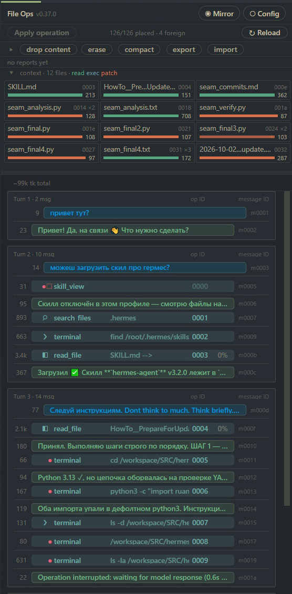

# hermes-filetools

**TL;DR**

**The goal: the user owns the context and runs the session — not the agent.** You see every
message the model receives, and you decide what stays, what gets edited, cut or compacted, and when.

- A plugin for [Hermes Agent](https://github.com/NousResearch/hermes-agent), built first of all
  for **Hermes Desktop**.
- **File tools** that answer in plain text, with an operation number on every answer.
- **A panel** in the desktop app: every message the model receives, editable in place, with an
  honest token counter.
- **Compaction by interrogation**: the model is questioned about the old part of the session,
  with a question set picked per topic, and the code builds the distillate from the answers.
  By hand or automatically. Tell it in your own words what to keep and what to drop, and look at
  the result **before** it goes into the session.
- **LLM operations** on any selection of messages: summarise, remove repetitions or your own
  prompt — then put the result in their place.
- **The price, known and chosen:** changing the past costs the provider's prompt cache — the
  prefix is computed again from the changed point. The plugin is aimed at **local LLMs** and at
  getting the most out of them, where a recomputed prefix costs time, not money.
- Verified on Hermes `d923a5eb48` (2026-10-16).

## Install

1. Install, and answer **yes** when Hermes asks to enable the plugin and to grant
   `tools.override`:

   ```
   hermes plugins install https://github.com/seneelya/hermes-filetools-release
   ```

   **IMPORTANT — the `tools.override` capability.** Our file tools replace Hermes' built-in ones
   under the same names, and Hermes allows that only with this capability. Your **yes** writes it
   into `<HERMES_HOME>/config.yaml`:

   ```yaml
   plugins:
     entries:
       hermes-filetools:
         granted_capabilities:
           - tools.override
   ```

   Without it Hermes loads the plugin but **silently keeps its own** `read_file` / `write_file` /
   `patch` / `search_files` / `terminal` — no error anywhere. Answered no, or not sure? Grant it
   now:

   ```
   hermes plugins enable hermes-filetools --allow-tool-override
   ```

2. **IMPORTANT — switch on our context engine.** Hermes does not do this for you, and without it
   there is no compaction at all (neither the button nor the automatic one) and no context
   operations from the panel:

   ```
   hermes config set context.engine ctxctl
   ```

   or add it to `<HERMES_HOME>/config.yaml` by hand:

   ```yaml
   context:
     engine: ctxctl
   ```

3. Close the desktop client, restart the gateway, open the client again:

   ```
   hermes gateway restart
   ```

Something does not work → [What Hermes' config must have](#what-hermes-config-must-have).



## What you get

### File tools with plain-text answers

`read_file`, `write_file`, `patch`, `search_files`, `terminal`, `execute_code`, `process`,
`vision_analyze` replace Hermes' built-in ones under the same names. The model reads text, not JSON;
every call gets an **operation number** (`Operation ID: 0015`) at the top of its answer. The panel
and the commands refer to it — and so can the agent, because it sees it. In a live conversation you
can say *"the file you read in operation 0015"* and the agent knows which one. (Message numbers —
`m0042` in the panel — the agent does NOT see during the conversation; use them in the panel, not in
chat.)

### The panel (Mirror)

Every message the model actually receives, in order, grouped by turn: your messages, the model's
replies, every tool call with its result. Click any of them for the full text, the full call, its
size in tokens. A `patch` call reads as a diff — lines that go on red, lines that come on green —
and the same new lines are marked in the file excerpt of its answer.

### Edit any message in place — without breaking the chain

Fix a reply or a request of yours right in the window (Edit → Save / Discard); the next turn sees
the corrected text. Tool calls, their results and the order of the conversation stay as they are. A
handy trick: put a label into one of your earlier messages and then say in chat *"in my message
marked [X] I wrote …"* — the agent sees the edited text and finds it.

### Save and load sessions as Markdown

Save one message or a whole selection as plain `.md` files, read and edit them in any editor, and
import the folder back — into the same session or into another one. Edit the text of messages
freely; **leave tool calls and their results alone** — a call and its result are a pair, and an
import with a broken pair is refused (or, if it slips through, confuses the model).

Yes, editing the past **breaks the provider's prompt cache** — the next request is computed from the
edited point on. That is a deliberate trade: sometimes the right context matters more than the
cache. This plugin is aimed first of all at **your own server with local LLMs**, where a recomputed
prompt costs time, not money.

### Trim the context by hand

Drop the body of a tool result you no longer need (a tombstone stays, the model knows something was
there) or erase whole messages.

### Our own token counter

It counts what the model really receives — the system prompt, the tool schemas and every message —
asking the model server's own tokenizer when it can (llama.cpp) and estimating otherwise, then
corrects itself by the real numbers the server reports. Even on a session you have just opened,
before any turn, it is far closer to the truth than the counter built into the desktop app. The
token strip in the panel and the auto-compaction threshold use it.

### LLM operations on a selection

Tick messages in the Mirror and open the LLMOps window: talk to a model about exactly those messages
(summarise them, remove repetitions, or your own prompt), edit the answer, and put it into the
conversation in their place. The reply is shown live as the model types it, and ■ Stop cuts it
off at once. Replies render as Markdown (the book view), raw text is one click away; the window
remembers its size and place.

### Compaction

See [How our compaction differs](#how-our-compaction-differs-work-in-progress).

### Config

In the panel, plus a check that the plugin still fits the Hermes you run
([Checking compatibility](#checking-compatibility-after-a-hermes-update)).

## How our compaction differs (work in progress)

Hermes' built-in compressor squeezes the old part of the conversation into a summary with a
summarising prompt. Ours replaces the chosen messages with a **distillate** built by **interrogating** a
model about them: question after question, layer after layer, following a **branching scheme** —
what the next question is depends on what the previous answers found. The point is to carry over
not a short retelling but what the continuation actually needs: decisions, facts that were
checked, what was tried and failed.

The model first names the topics of the chosen part, then — having seen a menu of question sets —
picks a set for each topic: work on a system, an investigation, a design, rules, a plain
conversation, a short exchange, or a neutral set for everything else (a story, a made-up world, a
plan). A literary session is not interrogated like code. The document is assembled by the code
from the answers, never glued together by the model.

**Not finished yet:**

- More question sets (literature and others) are planned.
- The plan is to also question the **"hot" agent** — the agent of the session itself, with its
  whole context still in front of it — **before** the compaction, so that the spirit of the
  session and the knowledge only it holds pass into the continuation instead of being lost. Not
  done yet.

You can start a compaction from the panel (pick the messages or take the suggested ones), and the
engine can do it automatically when the context fills up to a threshold you set in Config.

### Your wish for this compaction

Say in your own words what matters this time — *"keep only what we decided about plan 10, drop the
rest"*, *"this is a test, be as short as possible"*. The wish goes to the model as an instruction
with every question it is asked. Where to write it:

- the field in the panel's **Compact messages?** window;
- Hermes' own console command: `/compact <your wish>` (or `/compress <your wish>`) — it now runs
  **our** compaction, not Hermes' summary;
- our command: `/ctx-compact <what> <your wish>`, where `<what>` is a share (`0.8`, `80%`), message
  addresses (`m0001-m0010`) or `all` (every message, no protected head or tail). A bare number
  without `%` is an address: `80` means `m0080`.

### Which question sets the model may choose from

Config → Compaction → **question sets**: an unticked set is never offered, in any compaction —
switch off a set that works badly for you. The same ticks in the **Compact messages?** window apply
to that one run only. Hover a set to see its questions. `general` is the fallback and always stays.
`freeform` — no fixed questions, the model says in its own words what of the topic must survive —
is off by default.

### Preview before it touches the session

Tick **preview** in the **Compact messages?** window: the compaction runs as usual, but nothing is
written into the session. The distillate opens in the LLMOps window — read it, edit it by hand,
and press **Replace** to put it in; close the window and the session stays as it was. Compaction
cannot be undone, so this is the place to look first, or to run it again with another wish.

## What Hermes' config must have

The plugin works only with ALL of these entries in Hermes' `config.yaml`
(`<HERMES_HOME>/config.yaml`). Hermes writes the `plugins:` part itself when you answer **yes**
during install / enable; `context.engine` you add by hand. Check them if something does not work:

```yaml
plugins:
  enabled:
    - hermes-filetools
  entries:
    hermes-filetools:
      granted_capabilities:
        - tools.override        # REQUIRED: our tools replace Hermes' built-in ones by name
      capabilities_consent:     # written by Hermes when you grant the capability - do not edit
        hash: ...
        granted_at: ...
      allow_tool_override: true # older Hermes versions read this key instead
context:
  engine: ctxctl                # REQUIRED: our context engine - add this line yourself
```

- **`tools.override`** - without it Hermes loads the plugin but keeps its own `read_file` /
  `write_file` / `patch` / `search_files` / `terminal` - silently, no error. To grant it later:
  `hermes plugins enable hermes-filetools --allow-tool-override`.
- **`context.engine: ctxctl`** - without it our context engine is not selected: no compaction
  (button or automatic), no context operations from the panel. Add it by hand, then restart the
  gateway.
- Check: after a gateway restart `<HERMES_HOME>/logs/agent.log` has
  `capability_check plugin=hermes-filetools capability=tools.override decision=allow`.
- Python packages the plugin needs (`openpyxl`, `firecrawl-anydoc`, the `tree-sitter` grammars
  for reading code by blocks, and `pytest` for the full compatibility check) are installed by
  Hermes itself on install (`pip_dependencies` in `plugin.yaml`). The list also carries `ddgs` — not ours: Hermes' own `web_search` backend,
  which their installer leaves out (search then falls back to the keyless tier).

## Update

```
hermes plugins update hermes-filetools
```

Then restart the gateway with the desktop client closed.

This repository holds RELEASES only — one commit and one tag (`vX.Y.Z`) per version.
Development happens elsewhere.

## Your settings

`plugin.yaml` inside the plugin folder holds the DEFAULTS and is replaced by every update. What you
change in the panel (Config → Save) is written to `<HERMES_HOME>/filetools/settings.yaml` — only
the differences from the defaults — and survives updates. All data of the plugin (journal, engine
state, exports) lives under `<HERMES_HOME>/filetools/`.

## Which Hermes tools we replace, and what we changed

All of them keep Hermes' name, so the model and your habits stay the same. Each can be switched
back to Hermes' own version in Config → **Our tools** (`enabled` off).

| tool | what it is now |
| --- | --- |
| `read_file` | **Our implementation.** Plain text with a short header (size, lines, line endings), line numbers outside the file body, PDF / Word / Excel / PowerPoint / OpenDocument / RTF / EPUB / Jupyter files read as text (a scanned PDF is refused with a hint - no OCR). |
| `write_file` | **Our implementation.** Plain-text answer: what was written, how many lines, the encoding. |
| `patch` | **Our implementation.** Plain-text answer; a failed edit is a clear `ERROR …` line, never a silent repair. |
| `search_files` | **Our implementation.** Plain-text results instead of JSON. |
| `terminal` | **Hermes' own tool**, unchanged inside (approval, sudo, docker, sandbox — all theirs); we only turn its JSON answer into text. |
| `execute_code` | **Hermes' own sandbox**, unchanged inside; we turn its JSON answer into text, and the Python facade inside the sandbox gets our text answers too. |
| `process` | **Hermes' own process registry**, unchanged inside; text answer instead of JSON. |
| `vision_analyze` | **Hermes' own tool plus one bug fix.** On a Windows host Hermes parsed a container path (`/workspace/x.jpg`) with Windows path rules and the image was never found ("sandbox returned non-image data"). We read the image ourselves and hand Hermes the bytes — the model really sees images from container paths. |

Every answer starts with its operation number (above).

## Hermes tools we switch off

Hermes gives the model a set of tools to **drive the desktop app itself** — open a preview, focus
a pane, take a guided tour, switch a workspace, and so on (`desktop_preview`, `focus_pane`,
`set_theme`, `gui_tour`, `desktop_project`, `read_terminal`, `show_tip`, …). We did not ask for them, they
cost context on every request, and Hermes has no setting that removes them. So the plugin hides
them by default: the model does not see them at all. The panels themselves keep working — only the
model loses the ability to drive them.

Want one back? Config → **Disabled Hermes tools**: untick it, Save. Your choice is kept in your
settings and survives updates.

Once you have saved this list, it is **yours**: a tool Hermes adds later is not hidden by itself —
the plugin's own list only applies while you have not saved one. After a Hermes update, look at
this list in Config and tick the new names (this release adds `set_theme`).

## What changes in Hermes' own chat

Hermes' tools answer in JSON that the desktop app turns into nice cards (a file edit shown as a
diff, and so on). Our tools answer in text written for the **agent** to read, not for the app to
render — so the app's chat no longer shows those cards for `patch`, `write_file` and the other
replaced tools. Nothing is lost: every call and its full answer is in our panel (Mirror), in
more detail than before.

Hermes' console commands `/compress` and `/compact` run **our** compaction (the same as the
panel's, with your wish if you add text after the command) instead of Hermes' own summary.

## Checking compatibility after a Hermes update

**Much of this plugin depends on Hermes code that is not a public API** — the context engine's
access to the session, the gateway's memory, the tool registry, the way results reach the model.
There is no other way to reach these things, and a Hermes update can move or change them. That is
why every release names the Hermes commit it was verified on:

**This version was verified on Hermes `d923a5eb48` (2026-10-16).**

The same line is shown in the panel next to the check buttons. Running a newer Hermes? Run the
check below before trusting the plugin.

Config → Check Seams:

- **Check** — quick: verifies by search that every place this plugin hooks into Hermes' code is
  still there in the Hermes you run now.
- **Full check** — the same plus the behaviour tests shipped with the plugin (`tests/`, pytest,
  about 3 minutes). Use it after every Hermes update.

`FAIL` rows say what will stop working. The tests never touch your data (they run in a temporary
Hermes home).
